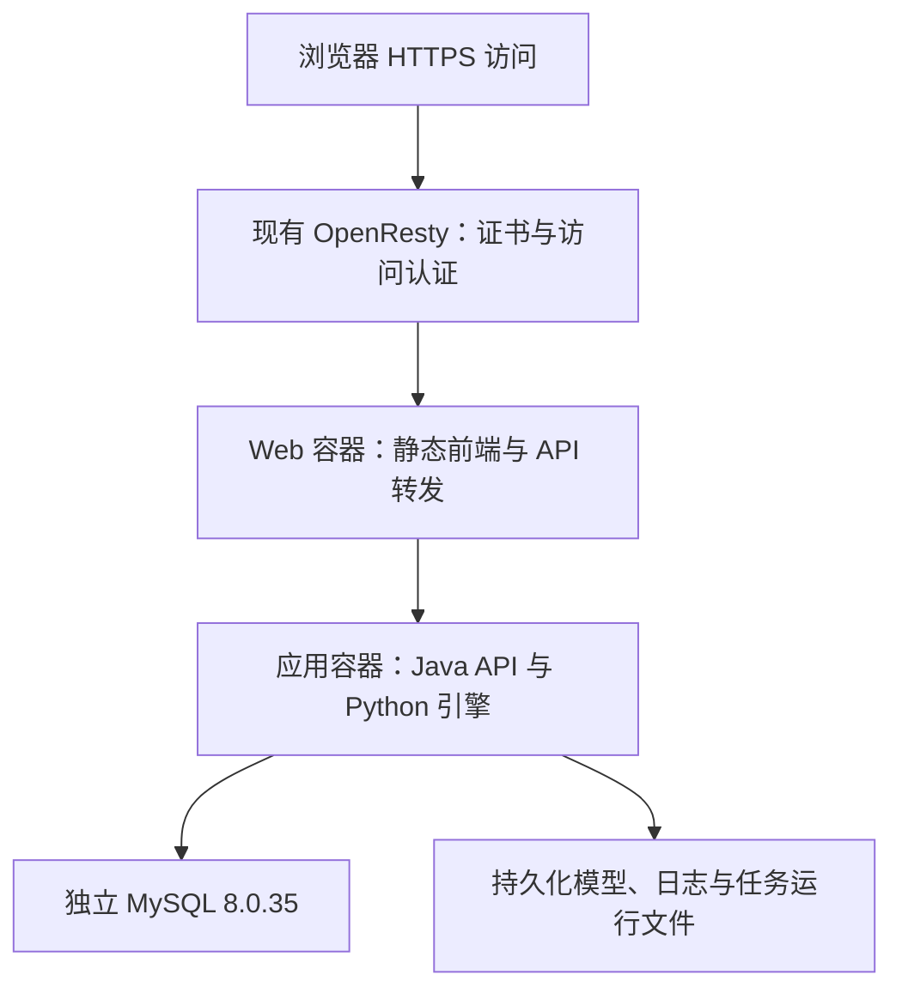

# 远端部署规划

> 状态：暂缓部署，仅保留规划。服务器资源暂时无法升级，当前继续使用 Windows 本地环境。本文件不代表 Linux 部署支持、容器镜像、HTTPS 或访问认证已经交付，也不触发任何远端安装、迁移或服务变更。

本文保留可公开的架构选择、兼容边界和后续验收要求。服务器地址、域名、账号、资源实测、现有业务清单、数据库快照、开发过程和本机目录等信息只保存在被 Git 忽略的本地文档中。

## 1. 可行性与资源前提

Java API、React 前端和 Python 概率引擎具备迁移到 Linux 的技术基础，但现有交付仍以 Windows 原生部署为准。后续需要补充 Linux 配置、依赖安装、服务管理和等价测试入口，不能直接把 Windows 启动脚本或虚拟环境复制到服务器。

对于同时承载其他业务的 2 核、8 GB 级别主机，网页展示和有限规模验收通常较轻，而全市场评分、训练、模拟与数据库竞争资源的情况必须实测。不能根据采集阶段的内存占用推断完整训练峰值，也不能照搬较大的 Java 堆配置而不核算 Python、MySQL、操作系统和其他服务的余量。

建议完整远端运行优先考虑至少 4 核、16 GB 的容量起点，并以实际负载测试确认。这是工程容量建议，不是保证任务一定完成的最低配置，也不是认定较小主机一定无法运行。磁盘容量应覆盖行情增长、索引、模型、日志、导入临时空间及多个可用备份，并设置保留期限。

当前决定是：**资源约束解决并重新确认部署前，不在远端开展试部署或正式部署，Windows 本地采集与计算方式保持不变。** 远端只展示、本地计算是另一种运行模式，若以后考虑，需要单独确认数据发布方式和功能限制；本规划不默认切换到该模式。

## 2. 候选部署架构

后续优先复用服务器已有的 OpenResty 入口，用独立 Docker Compose 项目管理平台组件，不接管其他业务的部署配置。

- **入口与网络**：新增独立站点配置；Web 接入可与入口通信的专用网络，API 和 MySQL 使用项目内部网络。优先不发布后端或数据库的公网端口。具体网络与端口在部署前重新核查，不能照搬本地验收端口。
- **前端**：使用正式构建产物，由 Web 服务器提供静态文件和单页应用路由回退；所有 API 统一通过同源 `/api` 访问。生产环境应禁止回退到浏览器所在机器的本地地址，并显式保留当前未启用模块的构建开关。
- **应用**：当前 Java 直接启动 Python CLI 子进程，首阶段保留该调用协议，将 Java 运行时、Python 解释器和引擎依赖放在同一应用容器内。把 Python 拆为独立网络服务属于额外架构改造，不包含在首阶段范围内。
- **数据库**：先保留独立 MySQL 8.0.35 实例以控制迁移变量，使用单独账号、数据卷和备份。数据库升级应另行验证，不能与迁移混在一起后仍宣称完全等效。
- **持久化与服务管理**：模型、日志、断点和数据库不放在临时容器层。设置资源限制、健康检查、重启策略和日志保留，并统一系统、Java 与 Python 时区为 `Asia/Shanghai`。

正式构建和镜像准备应避免挤占共享主机的生产资源；是否在构建机完成镜像后再上传，在实施时确定。

## 3. 访问与 HTTPS

现有应用尚没有完整的用户鉴权，采集、重算、任务运行和参数修改等接口不能直接作为匿名公网入口发布。

若仅个人或少量可信用户访问，可以先在 HTTPS 网关统一保护网页和 API。若需要公开只读页面、多人账号或不同管理权限，则应增加明确的应用权限边界，并单独验收。CORS 配置不能代替身份认证或接口授权。

证书签发与续期优先接入现有入口的管理方式；部署时检查域名解析、验证路径、SNI 站点匹配和自动续期。域名已解析不能作为网站或 HTTPS 已配置完成的证明。采用 HTTP-01 验证时，需要正确提供标准 HTTP 验证路径；只有选择 DNS 验证等具体方案后，才考虑是否需要额外 DNS 权限。

## 4. 数据、模型与版本兼容

以下均为实施前必须完成的适配或核验事项，当前没有因编写本规划而修改这些行为。

| 项目 | 迁移要求 |
| --- | --- |
| 数据库 | 使用一致性逻辑导出与导入，包含表、视图、历史预测、评估状态、任务与审计信息；不复制正在运行的 Windows 数据目录。 |
| 历史训练输入 | 保留历史样本外结果和排除状态，不能只搬行情或为了通过验收删除历史记录。 |
| 模型与元数据 | 同步模型文件和登记信息，对 Windows 绝对路径建立经过核对的 Linux 映射，并校验文件摘要；只有元数据、没有文件路径的登记应按原语义处理。 |
| Python 环境 | 根据依赖锁重新建立 Linux 环境，核验所需安装包；不复制 Windows 虚拟环境。 |
| 模型版本 | 当前有效配置中的数据库连接信息参与版本哈希，迁移账号或地址可能产生新版本。保留历史版本并记录映射，不能改写历史预测版本掩盖差异。 |
| 榜单取数 | 当前部分查询按版本字符串排序选取结果，新哈希并不保证排在旧哈希之后。部署前应确定基于成功批次或明确版本的选择策略，并完成回归测试。 |
| 断点与任务 | 断点身份包含模型版本，不能把旧完成标记直接当作新环境的计算进度；运行中任务也不能通过复制数据库自动迁移为继续运行。 |

股票与 ETF 的采集范围、ETF 隔离、评分口径、预测算法、模型参数和默认计算规模均属于受保护的业务边界。运行路径或版本选择的必要兼容调整应单独记录，不顺带修改算法来降低资源消耗。

## 5. 后续实施与验收顺序

资源条件允许并重新确认部署后，按以下顺序开展：

1. **准备隔离环境**：补充 Linux 构建和运行支持，使用独立数据库与运行目录；远端验收阶段关闭自动采集、训练和生产调度。
2. **导入验收快照**：检查表和视图、关键状态计数、模型登记与文件摘要，验证视图及配置不会指向本地生产库。
3. **执行兼容回归**：延续现有 Java、Python、前端和契约检查；在同一数据、日期、参数和随机种子下对比固定接口与计算结果。
4. **验证实际链路**：完成 Java 调用 Python、模型加载、受限规模预测、任务状态和错误日志的验证。最小任务成功不等于完整训练已验收。
5. **浏览器与入口检查**：验证 HTTPS、未登录访问限制、写接口保护、页面直达和刷新、榜单、详情、导出、任务轮询及失败提示；确认超时重试不会重复提交计算。
6. **资源与恢复测试**：观察完整目标工作负载的 CPU、内存、磁盘和数据库压力，验证资源限制、备份恢复及对其他业务的影响；未达到容量要求则不切换。
7. **最终同步与切换**：确认本地写任务空闲，安排短暂写入冻结，完成最终一致性快照和模型同步；验收后只启用远端作为生产写入与调度端。

数值验收应沿用已明确的容差，并记录平台、依赖和输入状态。跨系统 BLAS 或浮点运算可能产生细微差异，因此不承诺逐位一致；股票集合、离散状态、周期和计数应保持一致，临界分类差异需逐项解释，不能为通过测试自动放宽容差。

## 6. 回退与交付要求

- 切换前保留本地源码、数据库备份、模型及可用启动方式，记录远端镜像和配置版本。
- 两端不同时写入同一生产数据库或模型目录；恢复本地运行前先明确唯一写入端。
- 回退时核对切换后的新增数据，不直接用旧快照覆盖新数据。
- 发布验收记录必须区分“已测试”“未测试”和“仅规划”；不把构建成功、静态页面可访问或单元测试通过当作全量任务完成的证据。
- 实施完成后另行提供启动、停止、更新、日志排查、备份恢复和复测说明。当前文档不提供尚未验证的远端执行命令。

## 参考资料

- [Vite：生产静态部署与预览服务边界](https://vite.dev/guide/static-deploy)
- [Docker Compose：生产环境部署](https://docs.docker.com/compose/how-tos/production/)
- [Docker：容器资源限制](https://docs.docker.com/engine/containers/resource_constraints/)
- [Let's Encrypt：证书验证方式](https://letsencrypt.org/docs/challenge-types/)
